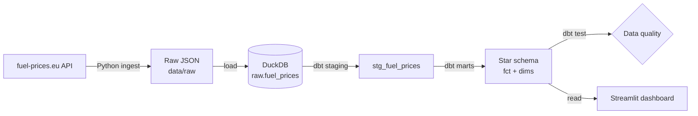
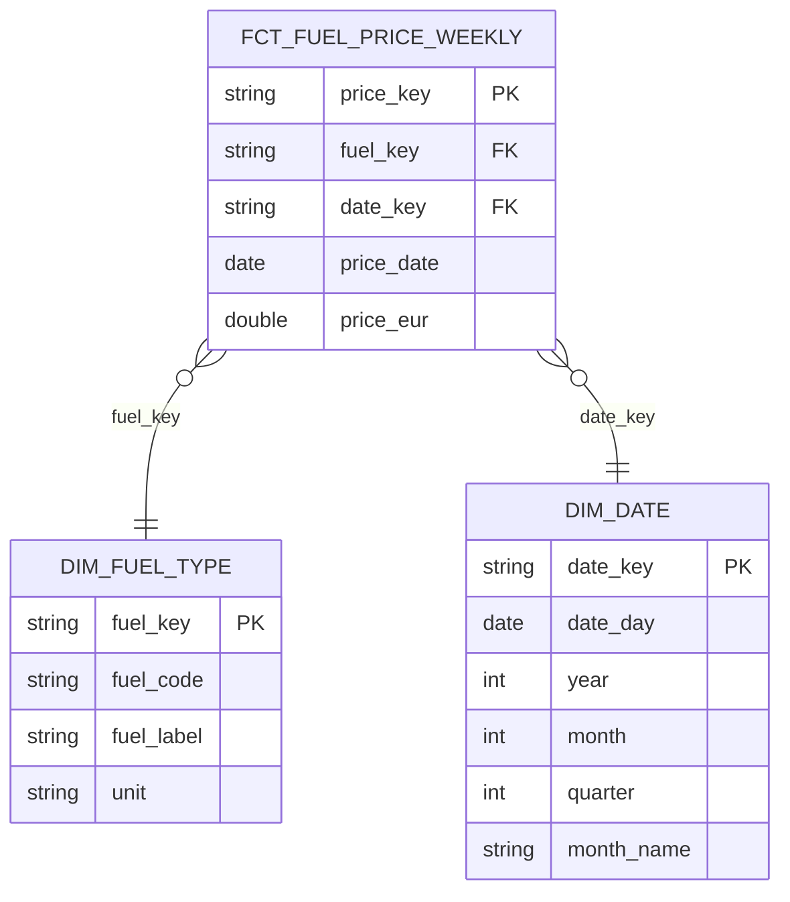

# ⛽ BG Fuel Prices — ELT Pipeline

An end-to-end **ELT data pipeline** for weekly Bulgarian fuel prices:
ingest from a public API → load into a warehouse → model with dbt → test →
visualise in a dashboard.

---

## 🏗️ Architecture



**Flow:** Extract (API) → Load (raw, untouched) → Transform (dbt) → Test → Visualise.

---

## 🧰 Tech stack

| Layer | Tool |
|-------|------|
| Ingest | Python (`requests`) |
| Warehouse | DuckDB (local) |
| Transform | dbt (`dbt-duckdb`) |
| Data quality | dbt tests |
| Dashboard | Streamlit + Plotly |
| Orchestration | GitHub Actions *(planned)* |

---

## 📊 Data source

Weekly pump prices (EUR/litre) for **petrol A95** and **diesel** in Bulgaria,
covering ~5 years.

> Data: [fuel-prices.eu](https://www.fuel-prices.eu), **CC BY 4.0** —
> based on the European Commission *Weekly Oil Bulletin*.

---

## 📐 Data model (star schema)



- **Fact** `fct_fuel_price_weekly` — one row per (week × fuel), measure `price_eur`.
- **Dimensions** `dim_fuel_type`, `dim_date` — descriptive context.

---

## 📁 Project structure

```
.
├── ingest/           # fetch raw data from the API
│   └── fetch_prices.py
├── load/             # load raw JSON into DuckDB
│   └── load_duckdb.py
├── dbt/              # transformation + tests
│   ├── models/
│   │   ├── staging/  # stg_fuel_prices + source definition
│   │   └── marts/    # dim_fuel_type, dim_date, fct_fuel_price_weekly
│   └── tests/        # custom data-quality test
├── dashboard/        # Streamlit app
│   └── app.py
├── data/             # raw snapshots + DuckDB file (warehouse gitignored)
└── requirements.txt
```

---

## 🚀 How to run

```bash
# 1. Environment
python -m venv .venv
.venv\Scripts\activate         
pip install -r requirements.txt

# 2. Ingest raw data
python ingest/fetch_prices.py

# 3. Load into DuckDB
python load/load_duckdb.py

# 4. Transform + test with dbt
cd dbt
dbt run  --profiles-dir .
dbt test --profiles-dir .
cd ..

# 5. Launch the dashboard
streamlit run dashboard/app.py
```

---

## ✅ Data quality

dbt tests enforce:

- **uniqueness** of surrogate keys
- **not-null** on keys and prices
- **referential integrity** (fact → dimensions) via `relationships`
- **accepted values** for fuel type
- a **custom test** asserting prices are strictly positive

---

## 📄 License

Code: MIT. Data: © fuel-prices.eu, CC BY 4.0.
